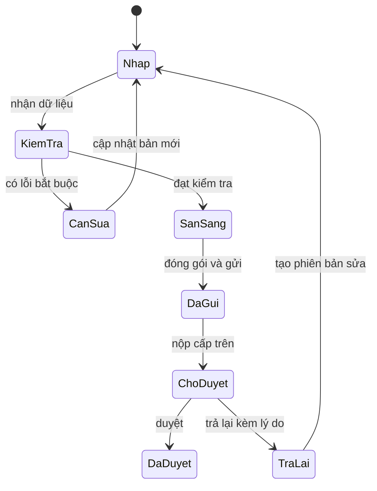

# Phân tích nghiệp vụ

## Bài toán thực tế

Tài liệu mô tả chuỗi chuyển đổi dữ liệu CAD có level và nhãn thành khoanh đất có thuộc tính, kiểm tra tính đúng đắn, tổng hợp số liệu, rồi gửi hồ sơ theo đơn vị hành chính và kỳ thực hiện. Vì vậy giá trị cần tái tạo nằm ở các hợp đồng dữ liệu và quy tắc có thể kiểm chứng, không phụ thuộc việc giao diện mới có giống giao diện cũ hay không. Đây là suy luận thiết kế từ DOC-A, DOC-B và DOC-C, chưa phải kết quả đọc mã VBDTK.

Khoanh đất trong kiểm kê không mặc nhiên đồng nhất với thửa đất địa chính hoặc hồ sơ quyền sử dụng đất. VLIS nên định nghĩa `LandBlock` cho kiểm kê và chỉ thêm quan hệ tới `Parcel` khi có nguồn dữ liệu và yêu cầu riêng.

## Chu trình đã quan sát

| Bước | Đầu vào | Kết quả | Chứng cứ |
| --- | --- | --- | --- |
| Chọn ngữ cảnh | Đơn vị hành chính, năm và loại kỳ | Phạm vi xử lý | DOC-A tr.1; DOC-C tr.2 |
| Nhận bản đồ | DGN đã biên tập | Khoanh đất và thuộc tính nhận từ bản đồ | DOC-A tr.1-3; DOC-C tr.2-4 |
| Nhập kỳ trước | Số liệu kiểm kê 2024 hoặc đồng bộ | Dữ liệu so sánh với năm 2025 | DOC-C tr.5-6 |
| Nhập biến động khác | Tăng khác, giảm khác | Khoản điều chỉnh có giải trình | DOC-C tr.7 |
| Kiểm tra | Mã đất, đối tượng, diện tích, topology | Danh sách lỗi; lỗi bắt buộc chặn tổng hợp | DOC-C tr.7-8,22-23 |
| Tổng hợp biểu | Dữ liệu đạt kiểm tra | Biểu và Excel | DOC-A tr.3-6; DOC-C tr.8-9 |
| Gửi dữ liệu | Hồ sơ, bản đồ, biểu | Dữ liệu được gửi lên hệ thống | DOC-A tr.6-7; DOC-C tr.9-10 |
| Nộp lên cấp trên | Hồ sơ đã kiểm tra và tài liệu | Chờ duyệt, khóa gửi lại | DOC-C tr.15 |
| Duyệt hoặc trả lại | Hồ sơ chờ duyệt | Được duyệt hoặc cho phép sửa lại | DOC-C tr.16-18 |

DOC-C tr.17 dùng màu xanh cho đã duyệt, vàng cho chờ duyệt và đỏ cho chưa gửi/chưa nộp. Đây là biểu đạt trạng thái; màu không nên trở thành trạng thái lưu trong cơ sở dữ liệu.

## Những mâu thuẫn cần giữ nguyên dấu vết

| Vấn đề | Nội dung quan sát | Quyết định thiết kế VLIS |
| --- | --- | --- |
| Cú pháp level 32 | DOC-B tr.1,6 có tiền tố loại đất hiện tại; DOC-C tr.21 có ví dụ đơn loại chỉ ghi mã đất kỳ trước | Tách profile theo nguồn; không dùng một regex và tự chọn cách hiểu |
| Chuyên đề level 6 | DOC-B tr.3-5 có cấu trúc chỉ tiêu và mã đất; DOC-C tr.22 minh họa dạng ngắn `DMD(1)` | Hai dialect; trường hợp thiếu ngữ nghĩa phải báo cần xác nhận |
| Chuyên đề level 12 | DOC-B tr.4-5 có loại đất/diện tích; DOC-C tr.22 minh họa mã chuyên đề đơn | Không suy diễn diện tích của mã đơn khi nguồn không quy định |
| Đối tượng kỳ trước | Cả hai tài liệu nói phân tách bằng dấu chấm phẩy nhưng ví dụ dùng dấu phẩy | Chế độ nghiêm ngặt báo xung đột; chế độ tương thích chỉ nhận dấu phẩy khi người dùng chọn profile đã xác nhận |
| Thứ tự khoanh | DOC-B tr.2 phân biệt kiểm kê và thống kê; DOC-C tr.22 quy định dãy từ 1 liên tục | Không tự đánh lại số đối với thống kê; rule gắn loại kỳ và profile |
| Cấp hành chính | DOC-A tr.8 còn nhắc huyện; DOC-C tr.15,18 thể hiện xã-tỉnh-trung ương nhưng tr.15 còn ghi tài khoản cấp huyện | Không hardcode ba cấp; lưu cây hành chính có thời gian hiệu lực và năng lực xử lý |
| Level 6 dùng lại | Bản đồ khoanh đất: chuyên đề NLT; bản đồ địa giới: mã xã | Khóa phân giải gồm `documentKind + profileId + level` |
| Bình sai một nét | DOC-B tr.1 mô tả cộng/trừ nhưng không cho công thức phân bổ | Chỉ ghi nhận yêu cầu; chưa chọn thuật toán thay cho nhà cung cấp |

## Trạng thái hồ sơ đề xuất

Sơ đồ sau là DESIGN. Trạng thái chi tiết và sự kiện là thiết kế mới; các hành vi khóa, duyệt và trả lại được DOC-C tr.15-18 hỗ trợ.

Mỗi lần gửi/nộp chỉ tham chiếu một snapshot bất biến. Việc trả lại mở một phiên bản mới và giữ nguyên bản từng nộp. Phản hồi HTTP thành công khi truyền tệp không tự đồng nghĩa đã nộp thành công hoặc đã duyệt. Đồng bộ sau mất kết nối phải kiểm tra trạng thái từ máy chủ, không tự đánh dấu được duyệt.

## Các biểu

DOC-C tr.5 đề cập Biểu 05/TKKK cho chu chuyển, tr.14 hiển thị Biểu 04/TKKK và Biểu 05/TKKK, tr.18-19 có Biểu 06/TKKK tại cấp tỉnh. Tài liệu không cung cấp trong phần phân tích này một hợp đồng đầy đủ cho từng ô, công thức và file mẫu của mọi biểu. Danh mục biểu và ma trận chỉ tiêu phải được xác nhận riêng trước khi công bố tương thích.

VLIS có thể tổng hợp số liệu nội bộ theo đặc tả độc lập. Dữ liệu phục vụ giao nộp chính thức cần đối chiếu mẫu biểu, gói dữ liệu và quy trình thực tế được cơ quan quản lý chấp nhận.
