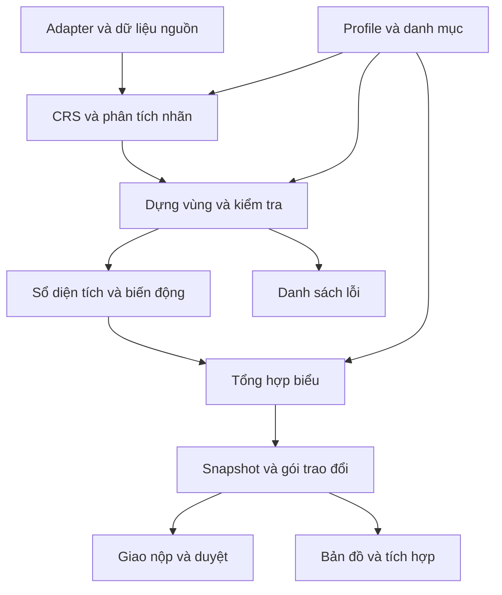

# Bản đồ thành phần đề xuất

Tất cả tên mô-đun ở đây là DESIGN của VLIS. Chưa có bằng chứng đây là danh sách DLL hay cấu trúc nội bộ VBDTK.

## Mười hai mô-đun có thể phát triển và thay thế riêng

| Mã | Thành phần | Trách nhiệm chính | Hợp đồng đầu vào/đầu ra | Điều nên giữ để dùng lâu dài |
| --- | --- | --- | --- | --- |
| M01 | Ngữ cảnh và danh mục | Kỳ, loại kỳ, ĐVHC, mã đất, mã đối tượng | `Context -> ResolvedCatalog` | Danh mục có phiên bản và ngày hiệu lực |
| M02 | Adapter định dạng | DGN/Excel và định dạng mở có quyền sử dụng | `Source -> RawElement + ReadReport` | Giữ level, text, ID, hình học và thông tin nguồn |
| M03 | CRS và đơn vị | Xác nhận hệ tọa độ, trật tự trục và đơn vị | `RawElement + CRSProfile -> MetricElement` | Không đo diện tích trên tile hiển thị |
| M04 | Phân tích nhãn | Đọc cú pháp theo level/dialect, tạo AST | `RawLabel + LabelProfile -> AST/Issue` | Giữ nhãn gốc; lỗi có vị trí ký tự |
| M05 | Dựng vùng và gắn nhãn | Polygonize line; tìm nhãn thuộc vùng | `MetricElement -> CandidateLandBlock` | Không tự ghép khi nhãn mơ hồ hoặc vùng hở |
| M06 | Kiểm tra dữ liệu | Topology, mã, ID, diện tích và phạm vi | `CandidateLandBlock -> ValidationReport` | Tách lỗi chặn và cảnh báo có thể giải trình |
| M07 | Phân bổ diện tích | Thành phần loại đất/đối tượng, kết hợp, điều chỉnh | `LandBlock -> AreaLedger` | Phân biệt diện tích vật lý và phần dùng kết hợp |
| M08 | Biến động giữa kỳ | Chu chuyển loại đất, thay đổi ĐVHC, tăng/giảm khác | `Snapshots -> TransitionLedger` | Không dùng số thứ tự nhãn làm ID ổn định |
| M09 | Tổng hợp và biểu | Nhóm theo chỉ tiêu, truy vết số liệu, xuất bảng | `Ledgers + ReportProfile -> ReportSnapshot` | Một lõi tổng hợp, nhiều mẫu biểu độc lập |
| M10 | Lưu trữ và đóng gói | Snapshot, gói trao đổi, manifest, hash | `Snapshot -> ExchangePackage` | Có thể đọc lại không cần chạy phần mềm cũ |
| M11 | Giao nộp và phê duyệt | Theo dõi gửi/nộp/duyệt/trả lại, khóa phiên bản | `Package + SubmissionEvent -> Status` | Tách giao thức hệ thống ngoài khỏi lõi |
| M12 | Trình bày và tích hợp | Bản đồ, bảng, QGIS/web/desktop về sau | `QueryResult -> Presentation` | Giao diện không giữ quy tắc thống kê duy nhất |

## Quan hệ lõi

Sơ đồ này thể hiện ranh giới thiết kế, không thể hiện DLL đã tìm thấy. Lõi M04-M09 không gọi máy chủ giao nộp, không đọc trực tiếp file CAD, không phụ thuộc biểu mẫu GUI. Adapter M02 chịu trách nhiệm chi tiết của định dạng; M12 chỉ hiển thị kết quả đã có nguồn.

## Hợp đồng lỗi dùng chung

Một `Issue` cần có `code`, `severity`, `blocking`, `sourceDocumentId`, `sourceElementIds`, `landBlockIds`, `location`, `rawValue`, `profileId`, `ruleId`, `messageVi` và `resolution`. Không được trả một giá trị diện tích 0 để che lỗi đọc nhãn hoặc thiếu CRS.

Mỗi bước ghi lượng đầu vào, lượng đầu ra, phần bị cách ly và lý do. Đọc lại cùng nguồn với cùng phiên bản profile phải tạo cùng kết quả ngữ nghĩa. Khi thuật toán thay đổi, tăng phiên bản và giữ khả năng đọc snapshot cũ.

## Những phụ thuộc cần tránh trong lõi

- Tên DLL, control giao diện hoặc tên bảng chưa được xác minh của nhà cung cấp.
- Mã đơn vị hành chính cố định hoặc bộ danh mục không có ngày hiệu lực.
- Điểm đăng nhập và giao thức riêng của một máy chủ.
- DGN trở thành nơi duy nhất giữ thuộc tính nghiệp vụ sau nhập.
- PMTiles trở thành nguồn để tính diện tích hoặc khôi phục ranh khoanh chính xác.

Phần triển khai về sau có thể dùng web, desktop, CLI hoặc plugin GIS. Việc chọn giao diện không làm thay đổi hợp đồng khoanh đất, ledger và profile.
